<div align="center">

  <a href="https://git.io/typing-svg">
    
  </a>

  <p>
    
    
    
    
  </p>

  <p>
    <a href="#-sobre-mim">Sobre mim</a> •
    <a href="#-forma%C3%A7%C3%A3o">Formação</a> •
    <a href="#-tecnologias">Tecnologias</a> •
    <a href="#-atividade">Atividade</a> •
    <a href="#-brincadeiras">Brincadeiras</a> •
    <a href="#-contato">Contato</a>
  </p>

</div>

---

### 🙋‍♂️ Sobre mim

Sou estudante de Tecnologia, apaixonado por programação e desenvolvimento de software. Este GitHub reúne meus estudos, exercícios e projetos desenvolvidos durante minha jornada na programação. 🚀

- 🔭 Atualmente estudando **desenvolvimento de sistemas**
- 🌱 Aprofundando meus conhecimentos em **C++** e **Python**
- 💬 Pergunte-me sobre **lógica de programação** e **algoritmos**
- 🎯 Objetivo: me tornar desenvolvedor(a) de software

<details>
<summary>✨ <b>Clique para ver curiosidades sobre mim</b></summary>
<br>

- 🎮 Gosto de aprender programação fazendo pequenos jogos e desafios
- ☕ Funciono melhor com café e uma boa playlist
- 📚 Prefiro aprender praticando do que só lendo
- 🚀 Meta de 2026: entregar projetos completos e subir tudo aqui

</details>

### 🎓 Formação

- ✅ Curso Livre de **Python** — SENAI
- ✅ Curso Livre de **C++** — SENAI
- 🔄 Cursando **Técnico em Desenvolvimento de Sistemas**

<details>
<summary>🗺️ <b>Meu roadmap de estudos (clique para abrir)</b></summary>
<br>

- [x] Lógica de programação
- [x] Python básico
- [x] C++ básico
- [ ] Estruturas de dados e algoritmos
- [ ] Banco de dados (SQL)
- [ ] Git e GitHub avançado
- [ ] Meu primeiro projeto completo

</details>

### 💻 Tecnologias

<p align="center">
  <a href="https://skillicons.dev">
    
  </a>
</p>

<p align="center">
  <sub>👇 Clique para abrir a documentação de cada uma</sub><br>
  <a href="https://en.cppreference.com"></a>
  <a href="https://docs.python.org/pt-br/3/"></a>
  <a href="https://learn.microsoft.com/pt-br/dotnet/csharp/"></a>
  <a href="https://git-scm.com/book/pt-br/v2"></a>
</p>

### 📊 Atividade

<p align="center">
  <a href="https://github.com/Eduardo-p86">
    
  </a>
</p>

<p align="center">
  <a href="https://github.com/Eduardo-p86">
    
  </a>
</p>

#### 🐍 Snake das contribuições

<p align="center">
  <picture>
    <source media="(prefers-color-scheme: dark)" srcset="https://raw.githubusercontent.com/Eduardo-p86/Eduardo-p86/output/github-contribution-grid-snake-dark.svg" />
    <source media="(prefers-color-scheme: light)" srcset="https://raw.githubusercontent.com/Eduardo-p86/Eduardo-p86/output/github-contribution-grid-snake.svg" />
    
  </picture>
</p>

### 🎲 Brincadeiras

<details>
<summary>🧠 <b>Mini quiz: você sabe o que esse código C++ imprime?</b></summary>
<br>

```cpp
#include <iostream>
int main() {
    int x = 5;
    std::cout << x++ + ++x;
}
```

<details>
<summary>👀 Ver a resposta</summary>
<br>

Esse código tem **comportamento indefinido** em C++, porque `x` é modificado duas vezes na mesma expressão sem ordem garantida entre as operações. O resultado pode variar de compilador para compilador (muitos imprimem `12`, mas nada garante isso). A lição: **nunca modifique a mesma variável duas vezes numa expressão**. 😉

</details>

</details>

<details>
<summary>🎯 <b>Desafio do dia: FizzBuzz em Python</b></summary>
<br>

Escreva um programa que imprima de 1 a 100, trocando múltiplos de 3 por `Fizz`, múltiplos de 5 por `Buzz` e múltiplos de ambos por `FizzBuzz`.

<details>
<summary>💡 Ver uma solução</summary>
<br>

```python
for i in range(1, 101):
    if i % 15 == 0:
        print("FizzBuzz")
    elif i % 3 == 0:
        print("Fizz")
    elif i % 5 == 0:
        print("Buzz")
    else:
        print(i)
```

</details>

</details>

<details>
<summary>📬 <b>Quer trocar uma ideia? Veja ideias de assunto</b></summary>
<br>

- 💡 Dúvidas de lógica ou algoritmos
- 🤝 Estudar junto ou trocar dicas de C++ e Python
- 🛠️ Ideias de projetos pequenos para praticar

</details>

### 📫 Contato

<p align="center">
  <a href="mailto:e3159946@gmail.com">
    
  </a>
  <a href="https://www.instagram.com/duduuxz010/">
    
  </a>
  <a href="https://github.com/Eduardo-p86">
    
  </a>
</p>

---

<div align="center">
  <sub>💡 Em constante aprendizado. Se curtiu algum projeto, deixe uma ⭐!</sub>
</div>
